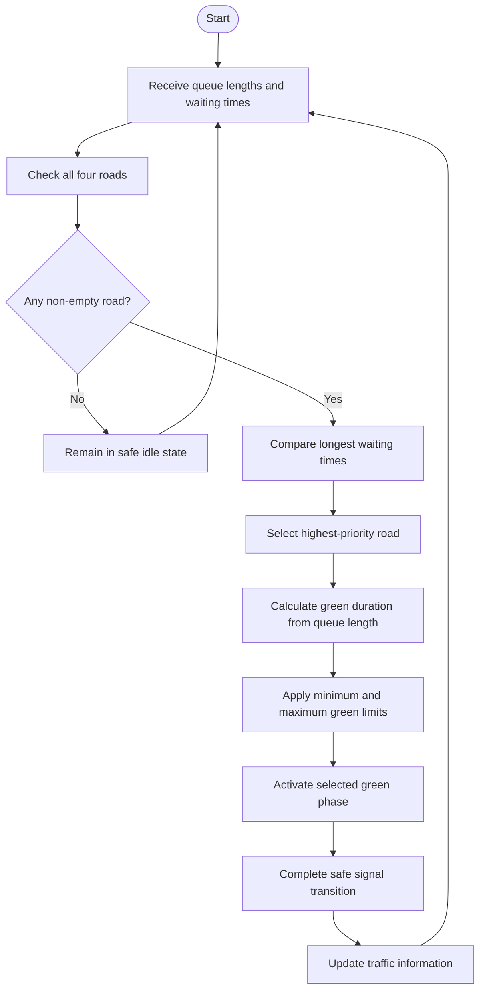

# Adaptive Traffic Signal Management Algorithm

## Unified Queue Prioritization and Dynamic Green-Time Allocation

**Version:** 1.0  
**Status:** Proposed algorithm and simulation specification

---

## 1. Problem Statement

Conventional traffic signals often use fixed green-light durations. However, traffic demand changes throughout the day: one road may have a long queue while another has very few vehicles.

A fixed-time system may therefore allocate green time inefficiently while vehicles on busier roads continue waiting.

**Objective:** Design a simple adaptive algorithm for a four-way intersection that selects which road should receive the next green signal and determines how long that signal should remain green.

## 2. What Our Algorithm Does

The proposed algorithm combines two decisions into one unified procedure:

1. **Queue Prioritization:** Select the non-empty road whose longest-waiting vehicle has waited the longest.
2. **Dynamic Green-Time Allocation:** Calculate the selected road's green duration using its queue length.

The algorithm repeats these steps as traffic conditions change.

## 3. System Model

The first implementation considers one isolated four-way intersection:

- North
- East
- South
- West

For each road, the algorithm receives:

| Input | Meaning |
|---|---|
| Queue length (`Q`) | Number of waiting vehicles |
| Maximum waiting time (`W`) | Waiting time of the longest-waiting vehicle |

The algorithm returns:

- Selected road
- Calculated green duration

**Assumption:** Queue information and waiting times are supplied to the algorithm. Vehicle detection and physical signal control are separate modules.

## 4. Algorithm Logic

### Step 1 — Calculate Road Priority

For every non-empty road:

\[
Priority_i = W_i
\]

The road with the highest priority is selected.

If two roads have equal maximum waiting times, the road with the larger queue is selected. If both values are equal, the first road in the configured approach order is selected.

### Step 2 — Calculate Green Duration

After selecting a road:

\[
G_{raw} = T_s + (Q_i \times T_v)
\]

\[
G = \min(G_{max},\max(G_{min},G_{raw}))
\]

Where:

- `G` = Allocated green time in seconds
- `Q` = Queue length of selected road
- `Ts` = Startup allowance
- `Tv` = Estimated service time per vehicle
- `Gmin` = Minimum green duration
- `Gmax` = Maximum green duration

**Illustrative simulation settings:**

| Parameter | Value |
|---|---:|
| Ts | 2 seconds |
| Tv | 2 seconds per vehicle |
| Gmin | 8 seconds |
| Gmax | 40 seconds |

These are demonstration values, not calibrated traffic-engineering parameters. They require testing and calibration.

### Step 3 — Execute and Repeat

The selected road receives the calculated green duration. After its service phase and the required safe signal transition, the algorithm receives updated queue information and repeats the process.

## 5. Pseudocode

```text
INPUT: Four road queues and waiting times

REPEAT:
    highestPriority = -1
    selectedRoad = NONE

    FOR each road:
        IF road queue is not empty:
            priority = longest waiting time

            IF priority > highestPriority:
                highestPriority = priority
                selectedRoad = road

            ELSE IF priority == highestPriority:
                select road with larger queue

    IF no road is selected:
        remain in safe idle state
        continue

    greenTime = startupTime + (queueLength * serviceTime)
    greenTime = clamp(greenTime, minimum, maximum)

    activate selected road's green phase
    complete safe signal transition
    update all road queues and waiting times

UNTIL system is stopped
```

## 6. Flowchart



## 7. Complexity

For `n` approaches:

- **Time Complexity:** O(n) per selection cycle.
- **Space Complexity:** O(n) for road data.

For the initial four-way intersection, `n = 4`.

## 8. Scope

### Included in the Initial Implementation

- One four-way intersection
- Four independent road queues
- Waiting-time-based road prioritization
- Queue-length-based green-time allocation
- Minimum and maximum green-time limits
- Software-based algorithm implementation and simulation

### Outside the Initial Scope

- Camera or sensor-based vehicle detection
- Physical traffic-light hardware integration
- Emergency vehicle prioritization
- Pedestrian crossing management
- Turning-lane optimization
- Coordination between multiple intersections
- Digital traffic challan system

These may be considered in future versions.

## 9. Limitations and Future Work

The proposed algorithm is currently a preliminary design. Its parameters are illustrative and have not yet been calibrated using real traffic observations.

The initial implementation will focus on validating the decision-making logic through software-based simulation.

Future work will evaluate the algorithm against fixed-time signal control using:

- Average waiting time
- Maximum waiting time
- Average queue length
- Vehicle throughput
- Total vehicle delay

Simulation results will be added after implementation and testing.

Real-world deployment would additionally require traffic data, field calibration, safety validation, and integration with a certified signal controller.

---

**Project Principle:** One unified algorithm makes both decisions — which road gets priority and how much green time it receives. Vehicle detection and physical signal safety remain separate supporting systems.

**Development Status:** Preliminary design. Implementation, testing, and performance evaluation pending.
